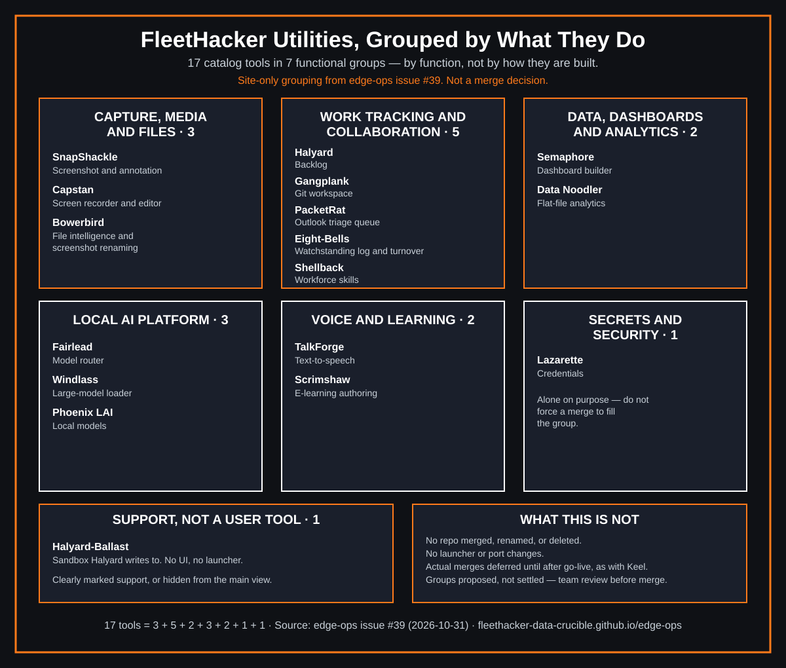

<p align="center"></p>

# FleetHacker Edge-Ops



FleetHacker utilities grouped by function.


Self-contained zip packages for edge automation and analysis. They load and run in user context on nearly any Windows machine, with **no admin rights and no runtime installs**.

This is the **hub** for the `fleethacker-data-crucible` utility suite. Every tool listed here is a separate repository with its own releases. **Browse the catalog:** open [`index.html`](index.html) (it works from GitHub Pages or straight from disk) or read [`catalog.json`](catalog.json).

   

## Target environment

- Windows with **app-whitelisting** (AppLocker/WDAC-style). Nothing to install.
- **Windows PowerShell 5.1** (built in). No PowerShell 7, Node, Python, or git.exe required.
- A **Chrome-engine browser** (Edge or Chrome) for HTML/JS user interfaces.
- **.bat** files only as a one-click launcher. **.vbs** only when needed, for example to hide a console window.
- Local servers bind to **loopback only** (`127.0.0.1`). See [PORTS.md](PORTS.md).

## Tools

| Tool | Category | What it does | Launch | Default port | Notes |
|---|---|---|---|---|---|
| [Halyard](https://github.com/fleethacker-data-crucible/Halyard) | PS host + browser UI | A product owner's assistant that works a backlog upward to leadership and downward to stories and tasks | `Launch-Halyard.bat` | free port | unreleased |
| [Halyard Ballast](https://github.com/fleethacker-data-crucible/Halyard-Ballast) | Support repo | The sandbox repository Halyard writes to: synthetic and copied work items, created, reviewed and deleted on purpose | - | - | sandbox |
| [Lazarette](https://github.com/fleethacker-data-crucible/Lazarette) | Security | Your credentials, stowed and locked aboard your own workstation | `Launch-Lazarette.bat` | 8765 | unreleased |
| [Gangplank](https://github.com/fleethacker-data-crucible/Gangplank) | PS host + browser UI | A browser-first workspace that gets people without Git training safely onto GitHub and GitLab projects, from Windows PowerShell 5.1 and a browser; no git.exe, Node or Python on the workstation | `Launch-Gangplank.bat` | 8769 | preview |
| [PacketRat](https://github.com/fleethacker-data-crucible/PacketRat) | PS host + browser UI | Outlook triage into a human-reviewed action queue, run from a local Windows PowerShell 5.1 service with a browser UI | `Launch-PacketRat.bat` | 8766 | prototype |
| [Shellback](https://github.com/fleethacker-data-crucible/Shellback) | Browser-only | Workforce capability intelligence: employee-attested skills, kept separate from claims, in a local-first browser app | `Launch-Shellback.bat` | 8765 | prototype |
| [SnapShackle](https://github.com/fleethacker-data-crucible/SnapShackle) | PS host + browser UI | A local-first Windows screenshot and annotation studio using native Windows capture, a built-in PowerShell HTTP host, and an offline browser UI | `Launch-SnapShackle.bat` | 8765 | prototype |
| [Bowerbird](https://github.com/fleethacker-data-crucible/Bowerbird) | PS host + browser UI | Local-first file intelligence and screenshot renaming for Windows PowerShell 5.1 and your existing web browser | `Start-Bowerbird.bat` | 8767 | unreleased |
| [Eight Bells](https://github.com/fleethacker-data-crucible/Eight-Bells) | PS host + browser UI | Local-first watchstanding log intelligence: quality review, evidence-linked turnover and lessons learned (v2) | `Launch-EightBells.bat` | free port | prototype |
| [Capstan](https://github.com/fleethacker-data-crucible/Capstan) | PS host + browser UI | An open-source, local-first screen recorder and video editor for Windows | `Launch-Capstan.bat` | 8790 | v0.1 |
| [Scrimshaw](https://github.com/fleethacker-data-crucible/Scrimshaw) | Browser-only | An open-source e-learning authoring tool | `Launch.bat` | local (not stated) | unreleased |
| [Semaphore](https://github.com/fleethacker-data-crucible/Semaphore) | Data & AI | Semaphore is a local-first dashboard builder for a single analyst, meant to replace Qlik on thin clients | - | - | v0.1 |
| [Fairlead](https://github.com/fleethacker-data-crucible/Fairlead) | Data & AI | One local address for every model | `Launch-Fairlead.bat` | 8776 | unreleased |
| [Windlass](https://github.com/fleethacker-data-crucible/Windlass) | Data & AI | Run very large local GGUF models (70B and up) on an ordinary PC by streaming them one layer at a time, behind an OpenAI-compatible API | `Windlass.bat serve --model <file.gguf>` | 8777 | v0.2; CPU; compiles C# at run time |
| [TalkForge](https://github.com/fleethacker-data-crucible/talkforge) | Browser-only | In-browser neural text-to-speech (Piper/WASM), offline | `serve.bat` | 25000 | Models ship in releases |
| [Data Noodler](https://github.com/fleethacker-data-crucible/data-noodler) | Data & AI | Flat-file analytics (CSV/Parquet/Arrow/SQLite) | `Data_Noodler.bat` | 8079 | Compiles C# at run time |
| [Phoenix LAI](https://github.com/fleethacker-data-crucible/phoenix-lai) | Data & AI | Local GPU LLM server (OpenAI API) + chat client | `Phoenix_LAI.bat` | 1234 | GPU; compiles C# at run time |

## Categories

- **Browser-only:** HTML/JS that runs from `file://` or a tiny static server.
- **PowerShell host + browser UI:** a PS 5.1 `HttpListener`/`TcpListener` on loopback serving a local web UI.
- **Support repo:** no code or UI to run (for example a sandbox another tool writes to).
- **GPU or build machine:** needs installs (for example Python), so it runs off the workstation, not on app-whitelisted Windows. No tool is in this category at the moment.
- **Data & AI:** heavier tools. Some compile bundled C# through the built-in .NET Framework at run time; some app-control policies block this.

## Running on a whitelisted Windows machine

1. Download `ToolName-vX.Y.Z.zip` from the tool's **Releases → latest** page and check it against the `.sha256` file:
   `Get-FileHash .\ToolName-vX.Y.Z.zip -Algorithm SHA256`
2. Right-click the zip → Properties → **Unblock**, then extract the **whole** folder.
3. Double-click the single `.bat` launcher. It runs `powershell.exe -NoProfile -ExecutionPolicy Bypass -STA -File …` for that process only. It never changes machine policy, and it does not override Group Policy or application control.
4. Your browser opens to `http://127.0.0.1:<port>/`. Close the console window (or press Ctrl+C) to stop. API-only tools such as Windlass open no browser; their tool page gives the address.

All tools are prototypes or previews unless stated otherwise. Get local authorization and a security review before using them with sensitive data.

## For maintainers

- [CONVENTIONS.md](CONVENTIONS.md): repo, README, launcher, and release rules.
- [docs/FLOWS.md](docs/FLOWS.md): the files Fleet apps hand to one another, and where each format is defined.
- [tools/fleet-loader/](tools/fleet-loader/README.md): the fleet snapshot manifest and its offline verifier (proposal, issue 34).
- [templates/TOOL-README-TEMPLATE.md](templates/TOOL-README-TEMPLATE.md): the README layout every tool uses.
- [.github/workflows/release-zip.yml](templates/workflows/release-zip.yml) (staged in `templates/workflows/` until moved by a token with `workflow` scope): reusable release packaging. In a tool repo:

```yaml
on: { push: { tags: ['v*'] } }
permissions: { contents: write }
jobs:
  release:
    uses: fleethacker-data-crucible/edge-ops/.github/workflows/release-zip.yml@main
    with:
      tool-name: SnapShackle
```

- To add a tool, edit `catalog.json`, then regenerate the offline fallback:
  `python3 -c "import json;d=json.load(open('catalog.json'));open('assets/catalog-data.js','w').write('window.EDGE_OPS_CATALOG = '+json.dumps(d,indent=2)+';\n')"`
  (or run the PowerShell equivalent in CONVENTIONS.md).
- Every tool has a `group` (an id from the top-level `groups` list in `catalog.json`, which also sets the heading order and names). That list and the tools' `group` fields are the only place groups are defined; the site reads them, and the hub offers a Group filter beside the Category filter and searches group names. A tool in no known group shows under "Other". Group names and membership are proposals until the team reviews them.
- Optional catalog fields: `installNote` (shown instead of the run steps when `requirements.installs` is true), `externalSource`, and `runNote`, which replaces the last run step on the tool page. Use `runNote` when "your browser opens" is wrong, for example an API-only server. A tool with a numeric `defaultPort` and `requirements.chromeEngine` false already gets neutral "no browser UI" wording.

## GitHub Pages site

- Landing page: `index.html` + `assets/`. Each tool also gets its own page, rendered from `templates/pages/tool-page.html` using `catalog.json`. The 404 page comes from `templates/pages/404.html`.
- Build locally (Windows PowerShell 5.1 or pwsh 7):
  `powershell.exe -NoProfile -ExecutionPolicy Bypass -File .\scripts\Build-Site.ps1` → `_site/` (git-ignored).
- Deploy: `templates/workflows/pages-deploy.yml` (manual `workflow_dispatch` only; `dry_run: true` builds and uploads the artifact without deploying).
- Live site: https://fleethacker-data-crucible.github.io/edge-ops/

## Go-live checklist (Nov 5, 2026, 12:00 PM ET)

GitHub Pages is already on: it serves `main` at `/` (legacy build) at https://fleethacker-data-crucible.github.io/edge-ops/. The landing page works; the generated `tools/<id>.html` and `404.html` pages are not published until the `pages-deploy` workflow is in place.

1. Add the workflows to `.github/workflows/` (web UI, or a token with `workflow` scope):
   `templates/workflows/pages-deploy.yml` → `.github/workflows/pages-deploy.yml` (being added by Zombie Admin) and
   `templates/workflows/release-zip.yml` → `.github/workflows/release-zip.yml`.
2. Once `pages-deploy` is in: Settings → Pages → **Source = GitHub Actions**, then Actions → **pages-deploy** → Run workflow (try `dry_run: true` first if you like, then run it for real).
3. Settings → General → Danger Zone → **Change visibility → Public**.
4. Check https://fleethacker-data-crucible.github.io/edge-ops/ and each `tools/<id>.html` page.

## License

MIT. See [LICENSE](LICENSE).
