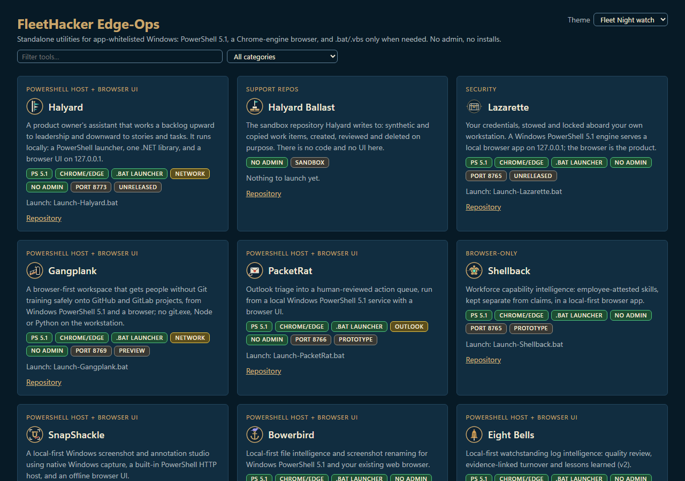
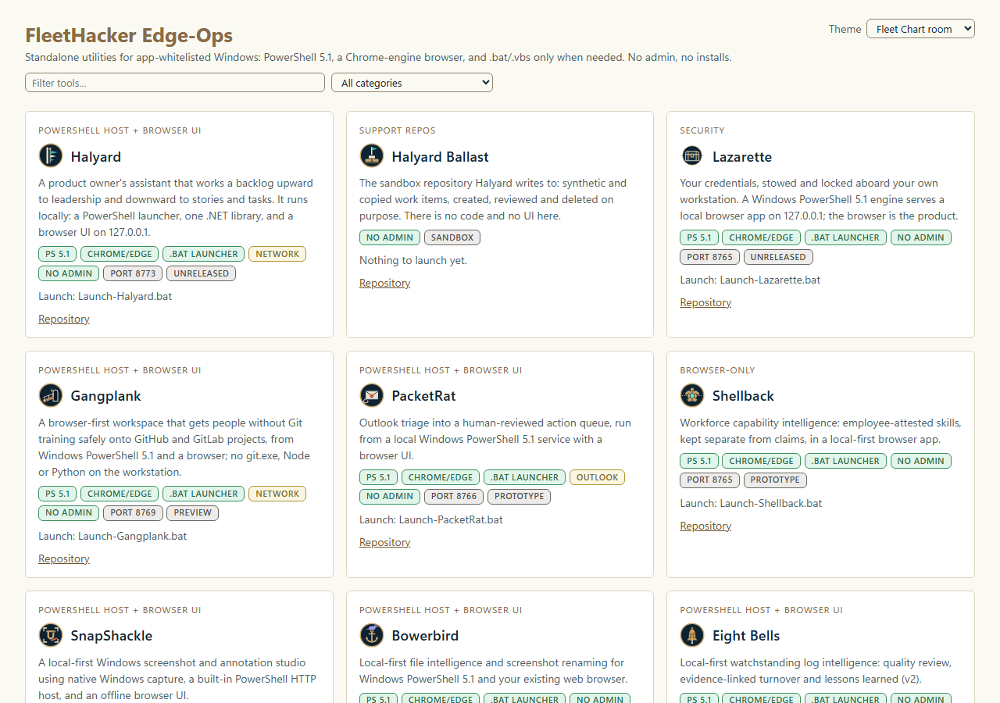

# Edge-Ops themes

Each theme is **one CSS file** in this folder. It sets every colour, font, radius and shadow token the hub uses on
`:root[data-theme=<id>]`, inside `@layer theme` (declared after the UI kit's `@layer kit`, so theme tokens win over
kit defaults, and the hub's unlayered `assets/style.css` only consumes them).

| File | id | Scheme | Notes |
|---|---|---|---|
| `phoenix-dark.css` | `phoenix-dark` | dark | Default dark. phoenix-lai palette (`#1b1b1b` / `#2a2a2a`, gold brand `#e8c15a`, blue actions `#2f74c8`). Also the no-JS fallback. |
| `phoenix-light.css` | `phoenix-light` | light | Default light. phoenix-lai `:root.light` (`#f4f3ef`, `#1e1d24`), gold darkened to `#735a06` for AA text. |
| `fleet-night-watch.css` | `fleet-night-watch` | dark | Optional. Fleet Unified UI Night watch: navy `#071a26` / `#112d40`, ivory text `#f4ead6`, brass actions and brand `#c9a66b`, Segoe UI and Cascadia Mono. |
| `fleet-chart-room.css` | `fleet-chart-room` | light | Optional. Fleet Unified UI Chart room: parchment `#fbfaf2`, white cards, navy text `#132633`, darkened brass `#7d6140` / `#8a6b45`. |

## Switching
- **Per user:** the *Theme* picker in each page header. "System default" (the default) follows the OS
  `prefers-color-scheme`. The choice is saved in `localStorage` (`edge-ops-theme`) and applies to every hub page.
- **In code:** set one attribute, `<html data-theme="phoenix-light">`, or call `EdgeTheme.set('phoenix-light')`.
- **Change the defaults:** edit `DEFAULTS` in `assets/theme.js`.

## Adding a theme
1. Copy `phoenix-dark.css` to `<id>.css`, change the selector to `:root[data-theme=<id>]` (drop the bare `:root`),
   set `color-scheme`, and change the values. Keep every token.
2. Add `<link rel="stylesheet" href="assets/themes/<id>.css">` next to the other theme links in `index.html`
   and `templates/pages/*.html`.
3. Add `{ id: '<id>', label: '…', scheme: 'dark'|'light' }` to `THEMES` in `assets/theme.js`.
4. Check WCAG 2.1 AA: text ≥ 4.5:1 on `--bg --side-bg --panel --panel-2`; `--focus` and `--border-strong` ≥ 3:1 on
   those surfaces; `--on-accent`/`--on-brand`/`--on-status` ≥ 4.5:1 on their fills. Then run axe and a keyboard Tab
   sweep in both normal and forced-colours modes.

## Screenshots

| Fleet Night watch | Fleet Chart room |
|---|---|
|  |  |
