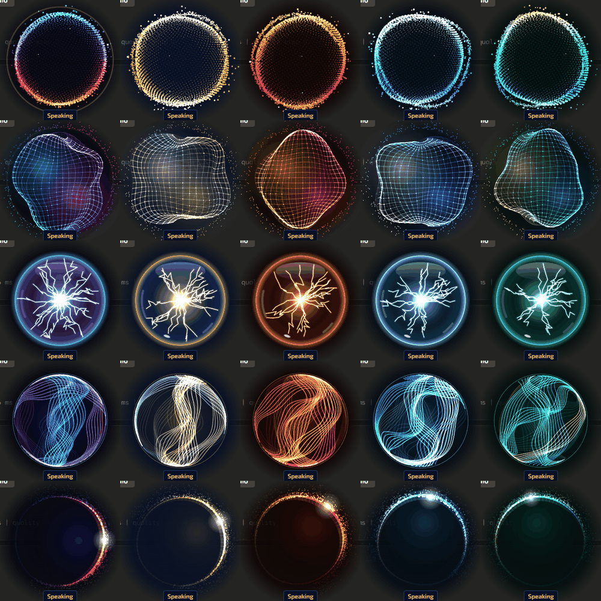
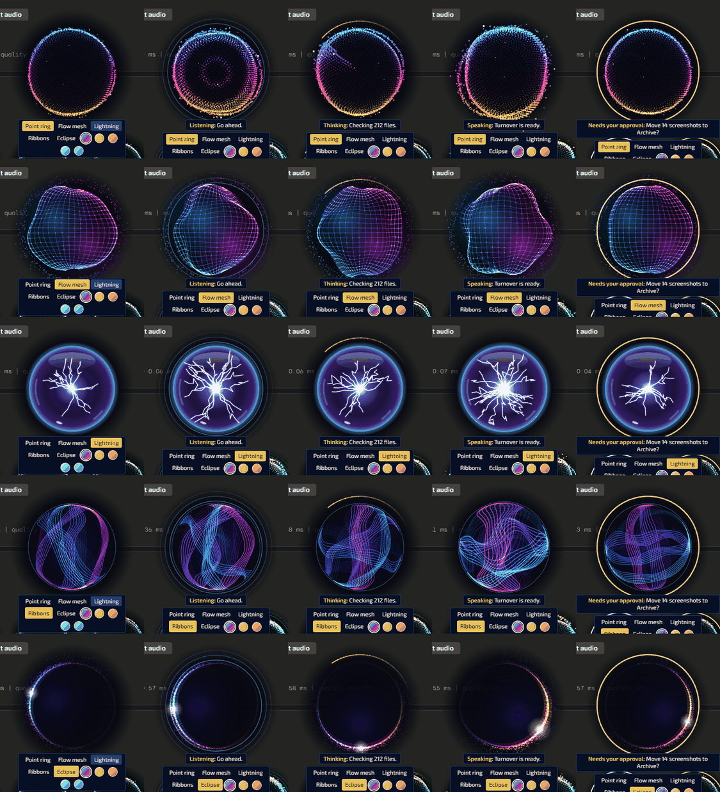

# Binnacle v0.1.0

A draggable animated orb for an AI assistant. It shows what the assistant is doing and reacts to live audio level. It is one classic script and one stylesheet with no dependencies, and it works offline from `file://` in Chrome and Edge. Nothing loads from a CDN. It is independent of the kit, so it also runs on pages that do not use `kit.css`.

It draws on a 2D canvas. WebGL would allow more particles, but it is often blocked or software-rendered on locked-down workstations.





## Try it
Open `demo.html` in a browser. It shows all 25 combinations live; click one to put it on the orb. Voice is simulated and no microphone is used.

## Looks and themes
| Looks | Themes |
|---|---|
| `ring` Point ring, `mesh` Flow mesh, `lightning` Lightning, `ribbon` Ribbons, `eclipse` Eclipse | `aurora` Aurora, `brass` Navy brass, `ember` Ember, `glacier` Glacier, `reef` Reef |

Every look works in every theme. Users choose from the picker that appears when they hover over the orb, and the choice is remembered.

## Add it to a page
```html
<link rel="stylesheet" href="vendor/ui-kit/binnacle/binnacle.css">
<script src="vendor/ui-kit/binnacle/binnacle.js" defer></script>
<script defer>
  addEventListener('DOMContentLoaded', function () {
    Binnacle.mount({ id: 'assistant', name: 'Phoenix' });
  });
</script>
```

| `mount` option | Default | Meaning |
|---|---|---|
| `id` | `assistant` | Key for the remembered position and look. Use a different id for each orb. |
| `name` | `Assistant` | Used in the screen-reader label. |
| `look` | `ring` | Any look above. One the user has chosen wins over this. |
| `theme` | `aurora` | Any theme above. One the user has chosen wins over this. |
| `size` | `260` | Width and height in CSS pixels, from 120 to 640. |
| `x`, `y` | Bottom right | Starting centre, in pixels. |
| `picker` | `true` | Show the look picker on hover and focus. |
| `caption` | `true` | Show the state and caption text under the orb. |
| `persist` | `true` | Remember position, look and theme in `localStorage`. |
| `inline` | `false` | Sit in the page flow as a tile, inside `parent`, with no dragging. Tiles run at 20 fps and stop while scrolled away. |
| `parent` | `document.body` | The element to add the orb to. |
| `zIndex` | `9000` | Stacking order. Set it below your dialogs. |
| `quality` | `auto` | `auto`, `high`, `medium` or `low`. |
| `reducedMotion` | System setting | `true` or `false` overrides `prefers-reduced-motion` and `[data-reduced-motion=true]`. |
| `onActivate` | None | Called on a click or Enter that was not a drag. This is the hook for push-to-talk. |

`mount` returns an object with `setLook`, `setTheme`, `moveTo`, `resetPosition`, `stats` and `destroy`, plus `look`, `theme` and `position`.

## Moving it
- Drag it with the mouse, pen or touch. Only the disc takes the pointer, so the page around it stays clickable.
- With it focused, the arrow keys move it (Shift for bigger steps) and Home sends it back.
- It stays on screen, and it returns to where it was if the window shrinks and grows again.
- A quick drag stirs the surface.

## States
| State | What it does |
|---|---|
| `idle` | Slow drift, dimmed, 30 fps. |
| `listening` | Rings leave the orb. The level moves it a little, for a microphone. |
| `thinking` | Fast spin with a radar arc. `working` is accepted as another name for it. |
| `speaking` | The surface swells and ripples with the audio level. |
| `approval` | Nearly still, with a steady ring. Pass the question as caption text. |

The state rings and arc are drawn the same way on every look, so a state reads the same whichever look is chosen.

## Voice interface (`fleet.voice/1`)
All orbs on a page share one voice bus. There are three ways to drive it.

**1. An event.** The sender needs nothing from this folder:
```js
window.dispatchEvent(new CustomEvent('fleet:voice', {
  detail: { schema: 'fleet.voice/1', state: 'speaking', level: 0.21, text: 'Turnover is ready.' }
}));
```
Every field is optional. `level` is linear RMS, 0 to 1, unsmoothed; send it 30 to 60 times a second, and the orb applies its own attack and decay. `text` is the caption. Unknown states are ignored, and a state change clears the caption unless the same event gives a new one.

**2. A direct call:** `Binnacle.voice.set(state, level, text)`, or `Binnacle.voice.setLevel(level)`.

**3. Real audio.** The page plays the audio and the orb measures it:
```js
var stop = Binnacle.voice.fromAudio(audioElement);   // speaking while it plays, idle when it stops
var stop = Binnacle.voice.fromAnalyser(analyserNode); // level only, for Web Audio playback
```
`fromAudio` must be called once per element, and audio from another origin needs CORS headers or the browser mutes it.

`Binnacle.voice.simulate(true)` stands in for audio until a real source is connected. Remove that one line when TalkForge is wired in.

## Slow machines and reduced motion
- With `quality: 'auto'`, the orb steps down when frames run slow: fewer particles, a lower pixel ratio and a lower frame rate. `stats()` reports the step it is on.
- `idle` and `approval` run at 30 fps, and animation stops in a hidden tab.
- With reduced motion set, the orb draws one still picture per state and does not animate. The caption still shows the state.

## Tests
The orb uses no inline styles or scripts, so it runs under `style-src 'self'`.

`tests/browser-check.mjs` drives headless Edge with real mouse input. It covers dragging, staying on screen, remembered position, click-through, keyboard, the picker, the voice event, every look in every state, level response, the real audio path, frame rate at normal speed and at 6x CPU throttle, and reduced motion. It needs Node 22 or newer and is not part of CI. From the repo root, with the server running in a second terminal:
```bash
python -m http.server 25191 --bind 127.0.0.1 --directory ui-kit
```
```bash
node ui-kit/binnacle/tests/browser-check.mjs "$TEMP/binnacle-check/shots"
```

## Licence
Our own code, under the repo's MIT licence. No third-party code or images. The stock reference images were used for look and feel only and are not in this repo.
